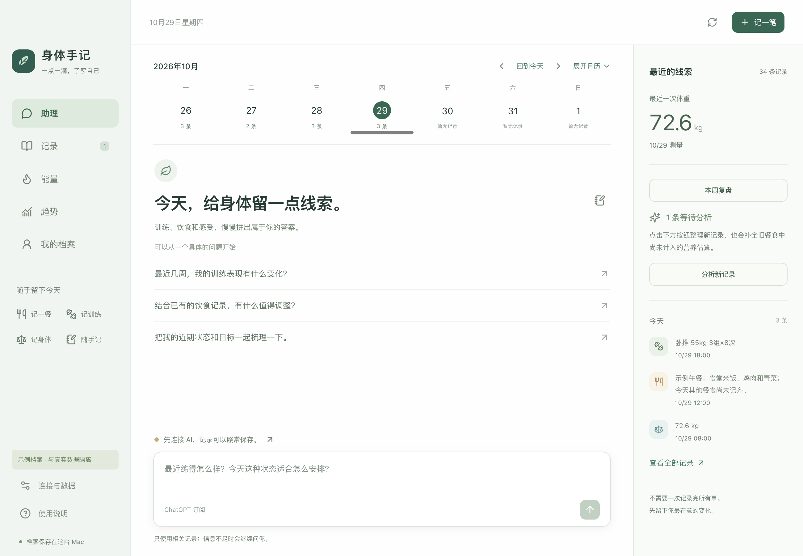
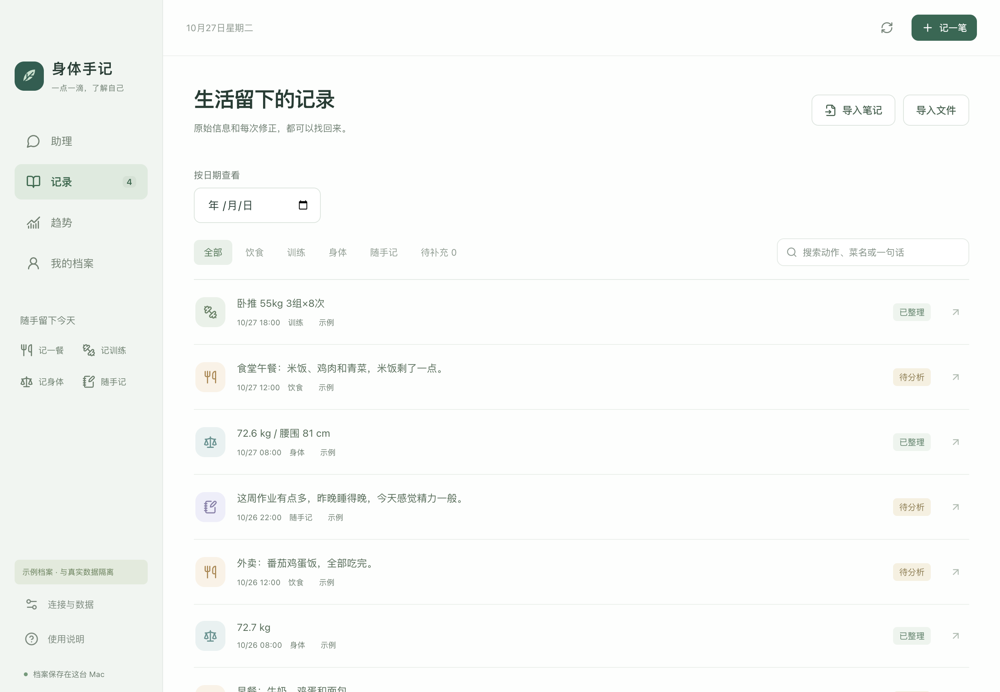
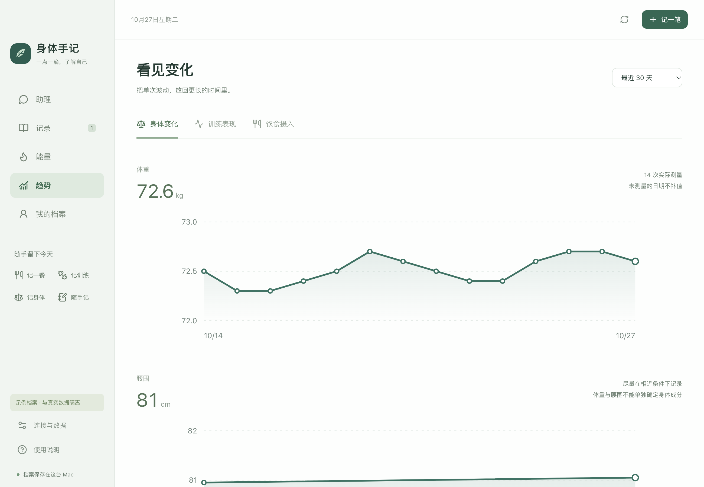
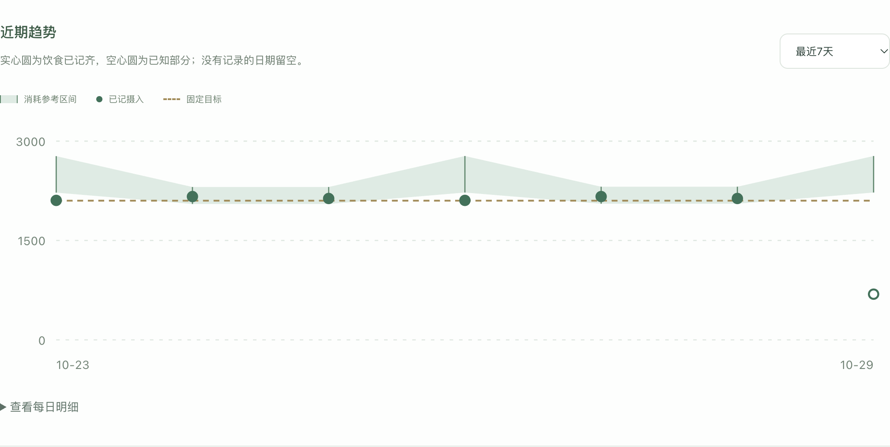

# BodyJournal · 身体手记

**A local-first journal that connects workouts, meals, body measurements, and everyday notes.**

Capture on iPhone with Apple Shortcuts, deliver through an iCloud inbox, and keep your journal on your Mac. Invoke AI when you want to interpret photos, review training, or discuss goals.

[Download](https://github.com/tenderzzz/body-journal/releases/latest) · [中文](README.md) · [Documentation (Chinese)](docs/README.md) · [Changelog](CHANGELOG.md)

[](https://github.com/tenderzzz/body-journal/releases/latest)
[](https://github.com/tenderzzz/body-journal/actions/workflows/macos-package.yml)
[](LICENSE)



## What it does

| Area | Features |
| --- | --- |
| Capture | Four iPhone shortcuts for meals, training, measurements, and notes; manual entries and pasted training notes on Mac. Saving records does not require a model connection. |
| Review | Workout volume, running, weight and waist trends; editable exercise names and weight conventions; original text, attachments and revision history. |
| Nutrition | Photo/text interpretation, ingredient and portion ranges, local nutrient calculations, saved package labels and references to previous meals. Missing meals are not counted as zero intake. |
| Energy | Local daily expenditure estimates, non-training step adjustments, overlap handling, source details and uncertainty ranges; stable food targets. |
| AI | On-demand chat and analysis using relevant records and memories; locally validated structured results; explicit acceptance of goal changes. |
| Data | Revisions, undo, soft deletion and recovery; editable memories; readable exports and full backups. |

**v0.5.2 (local implementation)** uses the macOS system-network session for authentication and model requests, processes the full pending-analysis queue with recoverable per-record results, preserves complete meal estimates during followups, finishes at the stream terminal event, distinguishes cancellation from timeout, and retains confirmed training notation, and adds versioned, time-aware memory with evidence and stale-answer handling; strict product identities; g/ml/serving nutrition labels and persistent meal corrections; fixed step-baseline snapshots; four-week trend review; and an offline accuracy evaluation panel. Backups use v4 and can restore v1–v3. See the [upgrade notes](docs/0.5.0升级说明.md) and [evaluation guide](docs/精度评测.md). Published downloads remain those actually available in Releases.

## Screenshots

| Records | Daily energy |
| --- | --- |
|  |  |

| Trends | Energy trends |
| --- | --- |
|  |  |

All screenshots use synthetic demo data. The application currently has a Chinese interface.

## Get started

The published build targets **macOS on Apple Silicon (arm64)**. This is a personal open-source project with an ad-hoc signature and **no Apple notarization**.

1. Download `body-journal-mac-arm64.zip` and `SHA256SUMS.txt` from the [latest release](https://github.com/tenderzzz/body-journal/releases/latest).
2. Run `shasum -a 256 body-journal-mac-arm64.zip` and compare the result with the checksum from the **same release**. Extract the app and move it to Applications.
3. If macOS blocks opening, review the app in System Settings → Privacy & Security.
4. Create a test record on Mac. Configure models when you need AI. For iPhone capture, sign the shortcut sources with your own Apple account and configure the shared inbox; see the [shortcut guide (Chinese)](shortcuts/开始安装.md).

The repository and release contain unsigned shortcut sources. They cannot be imported directly on iPhone. The [getting started guide (Chinese)](docs/getting-started.md) covers setup and troubleshooting.

### Run from source

Requires macOS Apple Silicon, **Node.js 24+**, and npm. Packaging also requires Xcode command line tools.

```sh
git clone https://github.com/tenderzzz/body-journal.git
cd body-journal
npm ci
HEALTH_DEMO=1 npm run dev
```

Quit any running instance first. Demo mode uses an isolated synthetic journal; plain `npm run dev` uses the real local journal. See [development documentation (Chinese)](docs/development.md) for architecture, tests and packaging.

## Privacy and limits

- The main journal lives in `~/Library/Application Support/BodyJournal/vault`. iCloud syncs the capture inbox, rather than the main SQLite database.
- Model requests are triggered by your actions. They can include selected text and photos, relevant historical summaries, profile information and memories. The app includes ChatGPT and DeepSeek adapters; account eligibility, model availability and billing depend on the provider and your configuration.
- Health records and exported backups are **not encrypted by the application**. Credentials use macOS-protected storage and are excluded from health backups. Soft deletion retains recoverable data. Details: [privacy documentation (Chinese)](docs/privacy.md).
- Energy and nutrition are estimates. Provisional step references are product assumptions, not individually validated expenditure measurements. This application does not provide medical diagnosis or treatment.
- Automated checks use synthetic data and mocked model responses. They do not establish live model quality, account access, or iPhone/iCloud reliability in your environment.
- Apple Health, automatic watch sync, a native iPhone app, proactive background advice, Windows and Intel Mac distributions are outside the current release.

## Contribute

Read [CONTRIBUTING.md](CONTRIBUTING.md) before opening a pull request. Use synthetic or redacted examples in [issues](https://github.com/tenderzzz/body-journal/issues/new/choose); never attach your health journal, credentials, or signed shortcuts. For vulnerabilities, see [SECURITY.md](SECURITY.md).

Code is licensed under [GPL-3.0-only](LICENSE). The ingredient catalog contains 7,793 USDA SR Legacy entries; see [data provenance](data/README.md). Chinese search labels do not represent measured nutrition for Chinese dishes.
