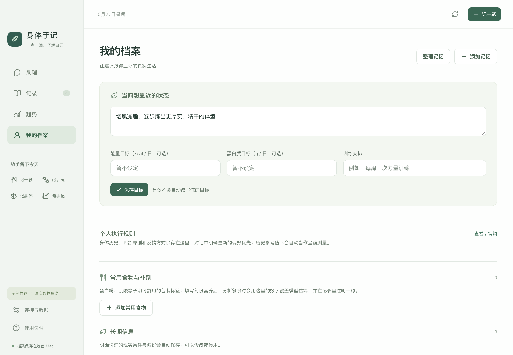
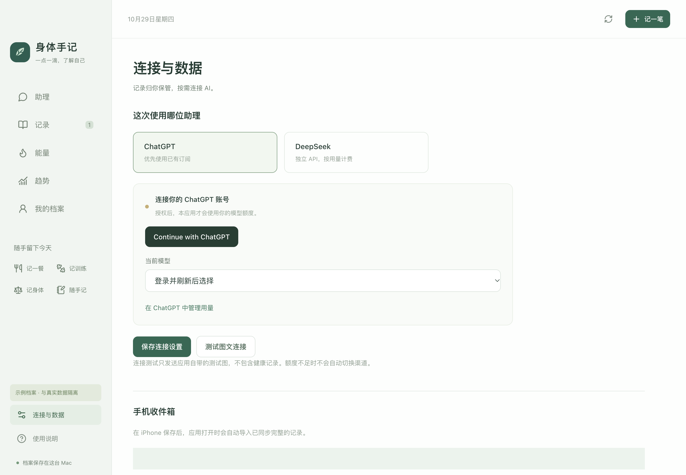

# 身体手记 · BodyJournal

[](LICENSE)


[](https://github.com/tenderzzz/body-journal/releases/latest)
[](https://github.com/tenderzzz/body-journal/actions/workflows/macos-package.yml)

> 本地优先的个人健康助理。iPhone 随手记录，通过 iCloud 同步；Mac 保存持续更新的训练、饮食、体重腰围和生活状态档案。默认只有你点击分析或提问时才调用 AI。


## 项目状态

这是一个**个人项目**：为自己使用而写，公开出来供参考和自用，不是商业产品；发布物均为 ad-hoc 签名的个人构建。

| 项 | 现状 |
| --- | --- |
| 当前版本 | `0.2.2`；标签 `v0.2.2`，安装包由 GitHub Actions 构建。 |
| 公开预编译安装包 | **[v0.2.2 Release](https://github.com/tenderzzz/body-journal/releases/tag/v0.2.2)**（2026-10-28）：`body-journal-mac-arm64.zip`，125,159,028 字节，SHA-256 `e296930a…c78c0a`，完整校验值见同页 `SHA256SUMS.txt`。v0.1.19 的本地构建已撤下。 |
| 签名与公证 | 本地开发签名（ad-hoc），没有 Apple Developer ID，也没有经过 Apple 公证，不是 App Store 发行版。首次打开可能被系统拦截，需在 Finder 中右键应用 →“打开”。 |
| 平台 | 仅 macOS Apple Silicon（arm64）。从源码构建需要 Node.js 24 或更高版本。 |
| 测试 | `npm test` 运行 105 项数据与模型契约测试，全部使用临时档案与合成数据。 |

## 它做什么

手机负责“随手记”，Mac 负责“连起来看”。

- 训练、饮食、体重腰围和生活感受先落成**不可篡改的原始记录**，再由本地程序做确定性统计。
- 只有需要理解文字或照片时，才把**显式组织过的上下文**交给所选模型；结构化结果还要通过本地校验才允许入库。
- 模型不直接写档案，也不直接算营养；没有后台调用，不会自动转到付费渠道。

## 功能

**记录**

- 助理、记录、能量、趋势、我的档案五个页面，另有「连接与数据」页负责模型连接、数据导出与恢复。
- 四个快捷指令：记一餐（拍照或只记文字）、记训练、记身体、随手记。每条记录独立编号，图片随 JSON 一次保存，文字以 UTF-8 Base64 保留标点和换行。
- iCloud 完整记录自动导入、重复编号去重、缺失图片等待同步、正文与原图独立归档。
- 原始记录修改、版本历史、撤销、软删除与恢复；修改会让相关的旧回答与推断失效。
- 手动修正动作、重量、组次和食材分量；可归档动作、指定计重口径、删除手动归类，也可软删除训练记录后再恢复。

**每日能量与目标问答（v0.2.0–v0.2.2）**

- 独立能量页：全天消耗参考区间、已记摄入、固定饮食目标、7／30天趋势与原始依据。
- 日常基线与完成训练分别计算，扣除重叠基线；缺力量时长时采用用户确认的常规范围，步数不重复加热量。
- 支持维持、减脂、增肌；原有手填目标优先保留，确认后保持稳定。只有饮食与活动记录完整时才判断参考缺口或盈余。
- 三个问答入口按需调用模型；热量调整草案经过本地校验，采纳后次日生效、可以撤销，依据变化后不能直接采纳。
- 升级前自动备份；数据库与备份格式v2，兼容恢复v1旧备份。四个手机快捷指令继续使用。详见[能量估算说明](docs/能量估算说明.md)。

**本地统计**

- 训练重量与容量、体重腰围趋势、饮食区间计算；7,793 条 USDA SR Legacy 食材数据及常用中文索引。
- 漏记的餐食不按零摄入处理；混合菜按原料与分量范围估算，匹配不到的部分单独显示。
- 动作按胸、背、肩、腿、核心分区显示。

**AI 接入与分析**

- 官方 ChatGPT 本地个人应用授权流程（OAuth + PKCE）、模型目录、图文流式请求；可选 DeepSeek Flash，带费用估计和本应用月预算。
- 分析时最多追问两个影响结论的关键问题；只有你明确采纳时才更新目标。
- 常用食物与补剂标签：包装标签（名称、品牌、每份克数与四项营养）可长期保存，分析时由本地强制按标签计算，不再让模型每次重估。
- 餐食引用复制：可以直接写“和 10 月 20 日午餐一样”，分析会从历史餐食里找到那一餐整份复制，再在本地重新计算营养。
- 反复出现的食材不会自动入库：同一食材累计出现在至少 2 餐时，在“我的档案 → 常用食物与补剂”显示候选卡片（出现餐数/天数、最近分量、营养来源），确认后才保存，也可以忽略。

**记忆与档案**

- 自动记忆：首页对话与分析会自动保存明确的长期信息（偏好、条件、记法、补剂标签）与短期状态；写入必须有原话或记录原文依据，数字不得凭空出现。分析结果会在记录详情显示“分析时自动记住”，可追溯来源，也可在档案里修改或撤销。
- 记忆分层：长期信息带稳定主题键（如 `communication.language`、`eating.environment`），按主题分组，同主题写入自动覆盖；聊天只带入与问题相关的记忆，按用途分配 800–2,400 字符预算（周复盘单独 1,600）。
- 短期记忆：对话上下文保留最近 20 条，并按问题关键词检索更早的相关对话；“最近的状态”显示剩余天数，可一键续期 7 天。
- 记忆整理：可一键整理（先自动完整备份）——删除失效的自动训练参照和过期状态、停用与常用食物重复的标签、合并完全重复的条目，并保留修订历史。
- 可读 Markdown / JSON / 原图导出；包含修订历史的完整备份，恢复前自动备份；凭据不随备份导出。

## 动作统计口径

同一动作只保留一种计重方式，避免把“单只/总重”拆成多份统计：

| 动作类型 | 计重口径 |
| --- | --- |
| 名字含“哑铃”、交替前平举、臂屈伸 | 单只重量 |
| 名字含“杠铃/史密斯”、深蹲、窄距卧推、碎颅者、保加利亚分腿蹲 | 报告总重 |
| 器械、绳索、蝴蝶机动作 | 器械标重 |
| 卷腹、举腿、俯卧撑、引体向上等 | 自重 |

哑铃肩推默认按坐姿记录，原文明确写站姿时才保留站姿；原文在同一行明确写“总重 / 双手合计 / 总负重 / 合计重量”时保留原文总重。旧记录会在升级后的首次启动时自动重新归一化，修改前自动建立完整备份，也可以在“整理动作名称”里手动调整归类、计重口径或归档动作。

## 截图

| 记录 | 趋势 |
| --- | --- |
|  |  |

| 我的档案 | 连接与数据 |
| --- | --- |
|  |  |

| 能量 | 能量趋势 |
| --- | --- |
|  |  |

截图使用内置示例档案（`查看示例.command`），与真实数据隔离。能量页的窄窗口布局证据见 `evidence/energy-compact.png` 与 `evidence/energy-profile-small.png`（同样来自合成示例档案）。

## 快速开始

### 下载预编译安装包

v0.2.2 的安装包由 GitHub Actions 在 macOS 托管 runner 上构建，发布在 [Releases](https://github.com/tenderzzz/body-journal/releases/tag/v0.2.2) 页面：

1. 下载 `body-journal-mac-arm64.zip` 并解压，把 `身体手记.app` 放进“应用程序”（或任意位置）打开。
2. 首次打开若被系统拦截，在 Finder 中右键应用 →“打开”。
3. 校验：`shasum -a 256 body-journal-mac-arm64.zip`，结果应为 `e296930aaa165150f5a1bf5aa6cd5e89543269a87d77b159bb4420e407c78c0a`（与 Release 页面的 `SHA256SUMS.txt` 对照）。

发布包是本地 ad-hoc 签名、未经 Apple Developer ID 公证的构建。CI 从干净检出构建，包内快捷指令只含 unsigned 源文件。

### 从源码构建

需要 macOS Apple Silicon、Node.js 24+、npm 和 Xcode 命令行工具（打包时会调用 `codesign`）。

```sh
npm ci
npm test          # 105 项数据与模型契约测试，使用临时档案与合成数据
npm run build     # TypeScript 检查 + 生产构建
npm run package   # 打包为 release/身体手记-mac-arm64.zip
```

然后双击项目根目录的 `打开身体手记.command`：它会把 `release/身体手记-mac-arm64.zip` 解压安装到 `~/Applications/身体手记.app` 并打开。开发窗口用 `npm run dev`。

只想看看界面，可以双击 `查看示例.command`，它会用内置示例档案打开，不读写真实档案。

### 首次使用

1. 打开应用，去“我的档案”检查目标和已知偏好；能量、蛋白质目标可以暂时留空。
2. 在“连接与数据”点 **Continue with ChatGPT**，在官方浏览器页面完成授权；回到应用选择账号可用的模型，保存设置，再点“测试图文连接”。测试只发送自带示意图。
3. 点击“建立并打开收件箱”。
4. 先试一条“随手记”，确认快捷指令显示“已保存”，再在 Mac 查看导入结果。手机端的相机和照片权限在首次使用时由你选择，快捷指令也可以添加到主屏幕。
5. 在“我的档案”补充目标和训练安排；已有训练笔记可以在“记录 → 导入笔记”里粘贴。

详细操作见 [使用说明](docs/使用说明.html)，各版本的验收范围与已知问题见 [验证记录](docs/验证记录.md)。

### 手机快捷指令

仓库**不包含已签名的快捷指令**：签名文件包含签名者的 Apple ID 签名验证记录，不适合公开分发，因此不进版本库（`release/` 目录同理）。`shortcuts/unsigned/` 中是可审查、可重建的源文件，不能直接导入 iPhone。

要用手机入口，请用自己的 Apple 账号生成并签名：

```sh
python3 scripts/build-shortcuts.py
shortcuts sign --mode anyone \
  --input "shortcuts/unsigned/身体手记·随手记.shortcut" \
  --output "shortcuts/身体手记·随手记.shortcut"
# 其余三个同理：身体手记·记一餐 / 记训练 / 记身体
```

签名可能需要联网。安装时把四份 `.shortcut` 放进 iCloud Drive 的 `Shortcuts/BodyJournal/inbox`；详见 [shortcuts/开始安装.md](shortcuts/开始安装.md)。

## 数据位置与隐私

| 内容 | 默认位置 |
| --- | --- |
| 本地主档案 | `~/Library/Application Support/BodyJournal/vault` |
| 数据库 | 主档案中的 `health.sqlite`，运行时还有 SQLite 日志文件 |
| 不变的原文与原图 | 主档案中的 `raw`、`attachments` |
| 系统保护的模型凭据 | `~/Library/Application Support/BodyJournal/credentials.enc` |
| 手机收件箱 | `~/Library/Mobile Documents/com~apple~CloudDocs/Shortcuts/BodyJournal/inbox` |

健康记录和凭据不存入源码目录。示例和自动测试使用独立临时档案。主数据库不放在 iCloud；iCloud 只承担收件箱同步。不要在应用运行时单独复制 SQLite 文件当作完整备份，请使用界面里的备份功能。

“本地优先”不等于完全离线：iCloud 文件经过 Apple 云服务，分析选中的原文和图片、回答需要的相关记录与个人档案会发送给当前选用的模型服务。没有后台模型调用。本地健康档案使用普通 SQLite 和文件存储，不是应用层全盘加密；模型凭据由 macOS 系统保护机制加密。

## 已知限制

- 真实 ChatGPT / DeepSeek 账号授权、实际模型额度和真实餐食照片的识别质量，需要你登录后自行验证；自动测试使用模拟流式响应，不消耗真实额度。
- 四个快捷指令需自行签名；iPhone 实际拍照、离线保存、跨设备 iCloud 同步需在你的设备上验证。
- 所有构建（包括 CI 发布的安装包）均为 Apple Silicon 上的 ad-hoc 签名个人构建，未经 Developer ID 公证，不是 App Store 发行版。
- Apple Health、手表自动同步、原生 iPhone App、后台主动建议不在当前范围。
- 中国食堂和外卖的混合菜不具备标准配方精度，只能按原料与分量范围估算；USDA 快照也不是中式菜谱库。
- 读取上下文默认最近 35 天，含“月”的问题扩至 90 天，历史类问题读取历史，最多 160 条。单条分析最多 4 张照片，单张原图上限 20 MB；完整备份上限 512 MB，暂不提供自动定时备份。
- 默认时区为 Asia/Shanghai。历史训练笔记只有日期时，导入时间设为当天 12:00（+08:00），详情可改。
- 应用预算只统计本应用发出的 DeepSeek 请求，按当前配置单价估算，不能控制你在其他应用里的调用；断流的费用预留会保留为“未确认”。

## 开发与验证

技术栈：Electron + React 19 + TypeScript，SQLite 使用 Node 内置驱动（`node:sqlite`）。渲染层开启 `contextIsolation`、关闭 `nodeIntegration`、开启 `sandbox`，IPC 只接受主窗口白名单内的调用；模型只能处理显式组织的上下文和通过校验的结构化结果，不能直接操作文件或执行命令。

```sh
npm ci
npm test          # 数据与模型契约测试（当前 105 项）
npm run build     # tsc --noEmit + Vite 构建 + esbuild 打包主进程
npm run test:ui   # Playwright 驱动真实 Electron 窗口的冒烟测试
npm run test:energy-ui # 能量页设置、固定目标、完整性、重启与窄窗口验证（不在 CI 中运行）
npm run package   # 产物写入 release/
```

图标与连接测试示意图可用 `swift scripts/make-icons.swift assets` 重建（生成 `assets/icon.iconset/` 与 `assets/connection-test.png`），再执行 `iconutil -c icns assets/icon.iconset -o assets/icon.icns` 生成应用图标。

目录说明：

| 目录 | 内容 |
| --- | --- |
| `electron/core` | 导入、版本历史、日期、营养、验证与本地统计 |
| `electron/ai` | ChatGPT 授权、DeepSeek 适配、SSE 解码与推理结果解析 |
| `src/ui` | 中文界面（React 19） |
| `tests` | 数据与模型契约测试（当前 105 项） |
| `scripts` | 构建、打包、快捷指令生成、桌面冒烟测试 |
| `data` | USDA 食材快照（来源与重建方式见 [data/README.md](data/README.md)） |
| `shortcuts` | 快捷指令源文件（`unsigned`）与安装说明 |
| `docs` | 使用说明与逐版本验证记录 |
| `evidence` | 界面截图 |

## 发布流程（维护者）

[`.github/workflows/macos-package.yml`](.github/workflows/macos-package.yml) 在推送 `v*` 标签时，由 GitHub 托管的 macOS（Apple Silicon）runner 自动完成：校验标签与 `package.json` 的 `version` 一致 → 安装依赖 → 运行契约测试 → 打包并解压验证 ad-hoc 签名 → 把 `body-journal-mac-arm64.zip` 与 `SHA256SUMS.txt` 发布到同名 Release。不需要 Apple Developer 证书，也不需要配置 secret；公开仓库使用标准 runner 不消耗 Actions 配额。

> 发布记录：**v0.2.2**（2026-10-28）由 GitHub Actions 在 `macos-26-arm64` runner 上构建并发布，整次运行约 1 分 12 秒（[运行记录](https://github.com/tenderzzz/body-journal/actions/runs/40548384634)）。v0.1.19 的本地构建已撤下，不再提供下载。

```sh
# 1. 更新版本号（package.json 与 package-lock.json），提交
npm version 0.2.3 --no-git-tag-version
git commit -am "Bump version to 0.2.3"
# 2. 打标签并推送，工作流会自动构建并发布 v0.2.3
git tag v0.2.3
git push origin main v0.2.3
```

只想试构建、不发布：Actions → **macOS 安装包** → **Run workflow**，`tag` 留空，产物在本次运行页的 **Artifacts** 中保留 30 天。要重新上传某个已有版本的资产，`tag` 填该标签再运行，同名资产会被覆盖。

> 本地 `npm run package` 会把本机 `shortcuts/` 目录整个打进应用资源；如果你在本地生成了已签名的 `.shortcut` 文件，请只把“CI 从干净检出构建的发布包”对外分发，不要分享本地构建的 zip。

## 许可证与数据来源

Copyright (C) 2026 tenderzzz。本项目以 **GNU General Public License v3.0** 发布，全文见 [LICENSE](LICENSE)。你可以自由使用、修改和分发，衍生作品必须同样以 GPL-3.0 开源并保留源代码。

`data/foods.json` 来自 USDA FoodData Central SR Legacy（公有领域 / CC0）；其中中文名称是搜索辅助翻译，不表示中国食堂菜品的实测。npm 依赖遵循各自许可证。

## 免责声明

本项目不是医疗器械，不提供诊断或治疗建议，任何输出仅供参考；健康相关决定请咨询医生或专业人士。数据默认保存在本机，模型调用会把相关记录发送给你选择的服务商；请自行备份，开发者不对数据丢失、模型输出错误或由此产生的后果负责。软件按 GPL-3.0“按现状”提供，不附带任何担保。

## 官方接口与数据依据

核对日期：2026-10-24。接口能力和资格由服务商决定。

- [OpenAI：Sign in with ChatGPT](https://developers.openai.com/cookbook/articles/sign-in-with-chatgpt)
- [OpenAI：本地应用授权](https://developers.openai.com/siwc/token-sharing-open-source/sign-in)
- [OpenAI：模型目录与推理](https://developers.openai.com/siwc/token-sharing-open-source/models-and-inference)
- [OpenAI：预览限制](https://developers.openai.com/siwc/token-sharing-open-source/preview-limitations)
- [DeepSeek：图像输入](https://api-docs.deepseek.com/guides/vision/)
- [DeepSeek：价格](https://api-docs.deepseek.com/quick_start/pricing/)
- [USDA FoodData Central](https://fdc.nal.usda.gov/api-guide/)；完整快照来源、哈希与处理过程见 [data/README.md](data/README.md)。
