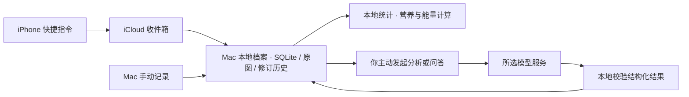

# 身体手记 · BodyJournal

**把随手记下的训练、饮食与身体变化，连成一份看得懂、可追溯的个人档案。**

手机用快捷指令记录，iCloud 负责送达，Mac 本地保存与计算。需要理解照片、复盘训练或讨论目标时，再由你主动调用 AI。

[](https://github.com/tenderzzz/body-journal/releases/latest)
[](https://github.com/tenderzzz/body-journal/actions/workflows/macos-package.yml)

[](LICENSE)

[下载应用](https://github.com/tenderzzz/body-journal/releases/latest) · [开始使用](docs/getting-started.md) · [文档](docs/README.md) · [English](README.en.md)


## 为什么做这个

训练笔记、餐食照片、体重和当天感受通常分散在不同地方。身体手记把它们放在一起：先留下原文与原图，再整理成能核对、能修正的记录，让复盘和提问有据可查。

这是一个持续迭代的个人开源项目，适合愿意自己管理数据、使用 Mac 和 iPhone 记录生活的人。当前界面为中文，发布平台为 **macOS Apple Silicon（arm64）**。

## 能做什么

| 你想做的事 | 身体手记如何帮助 |
| --- | --- |
| 先把今天记下来 | 四个 iPhone 快捷指令：记一餐、记训练、记身体、随手记；Mac 也支持手动新增和粘贴历史笔记。保存记录不需要连接模型。 |
| 看训练有没有进展 | 整理动作、计重口径与组次，查看训练容量、跑步和体重腰围趋势；原文、修改历史和统计依据可以回看。 |
| 理解饮食记录 | 图文分析拆解食材与分量范围，本地计算营养；常用食物可以保存包装标签，重复餐食可以引用历史记录。漏记不按零摄入处理。 |
| 理解每天的能量变化 | 本地估算日常消耗与已完成训练，结合非训练步数调整，展示区间、来源与缺失项；饮食目标保持稳定。 |
| 带着自己的记录问问题 | 按需提问、训练复盘与目标讨论；相关记录和记忆组成上下文，目标调整草案需要你确认才生效。 |
| 管理自己的档案 | 原文修订、撤销、软删除与恢复；长期偏好、短期状态和常用食物可修改；支持可读导出与完整备份。 |

### v0.5.2 本地更新

- **餐食补充可恢复**：保留上次食材估算和原问题，失败可查看旧结果；收到回答完成标志后立即保存，区分取消和超时。

- 分析显示完整队列进度、逐条结果和可恢复失败；训练补充保留问题上下文，已确认记法可复用。
- **系统代理兼容**：模型连接和登录统一采用Mac系统网络通路，网络故障给出具体提示。
- **记忆可追溯、可更正**：查看来源和版本，回答可展开所用记忆；过期或已更正的依据会使旧回答失效。
- **饮食修正更准确**：区分产品口味与规格，支持克、毫升和份，记录剩饭比例，本餐营养更正会跨重分析保留。
- **固定步数基准**：参考步数与日常基线成对保存，持续多走路的修正不会被滚动参考抵消；增加运动来源对照与四周趋势。
- **本地精度评测**：主动选择含参考和预测的文件，在本机计算误差、覆盖率与重复波动，不自动调用模型。

见 [升级说明](docs/0.5.0升级说明.md)、[精度评测](docs/精度评测.md) 和 [变更记录](CHANGELOG.md)。源码与本地构建为 v0.5.2，公开下载仍以 Releases 实际资产为准。

## 看看界面

| 记录与原始依据 | 每日能量 |
| --- | --- |
|  |  |

| 长期趋势 | 能量趋势 |
| --- | --- |
|  |  |

截图全部来自隔离的合成示例档案。更多页面见 [我的档案](evidence/profile.png)、[连接与数据](evidence/settings.png)。

## 开始使用

1. 前往 [Releases](https://github.com/tenderzzz/body-journal/releases/latest)，下载 `body-journal-mac-arm64.zip` 与同页校验文件，核对后解压，将 `身体手记.app` 放入应用程序目录。
2. 先在 Mac 新增一条测试记录；不连接 AI 也可以保存、编辑和查看本地记录。
3. 需要手机记录时，按 [快捷指令安装说明](shortcuts/开始安装.md) 用自己的 Apple 账号签名四个入口，再配置 iCloud 收件箱。
4. 需要图文分析与问答时，在“连接与数据”配置模型，在“我的档案”和“能量”补充资料与目标。

发布包为 **ad-hoc 签名，未经 Apple 公证**。首次打开可能需要在“系统设置 → 隐私与安全性”中允许打开。完整安装、模型连接、备份与常见问题见 [开始使用](docs/getting-started.md)。

### 从源码运行

需要 macOS Apple Silicon、**Node.js 24+** 与 npm；打包还需要 Xcode 命令行工具。

```sh
git clone https://github.com/tenderzzz/body-journal.git
cd body-journal
npm ci
HEALTH_DEMO=1 npm run dev
```

示例模式使用独立的合成档案。退出已运行的应用后再启动；普通 `npm run dev` 会使用正式本地档案。测试、架构、打包与发布流程见 [开发说明](docs/development.md)。

## 数据怎样流动



- 主档案默认位于 `~/Library/Application Support/BodyJournal/vault`；iCloud 同步的是手机收件箱，主数据库保存在 Mac 本机。
- AI 只在你发起分析、提问或连接测试等操作时调用。除选中记录外，请求可能包含相关历史摘要、个人档案、记忆和照片；不会自动转到另一家付费服务。
- 健康档案与导出备份没有应用层加密；模型凭据使用 macOS 系统保护的存储。软删除保留可恢复内容。
- 通过应用导出、备份和恢复，凭据不随健康备份导出。更多细节见 [隐私与数据说明](docs/privacy.md)。

## 使用前需要了解

- 热量、营养和训练分析都是参考估算。混合菜的用油与分量、训练时长及步数来源会影响结果；暂定步数范围是产品假设，尚未经个体能耗验证。
- 自动测试使用合成数据和模拟模型响应。真实模型授权、额度、照片识别质量，以及 iPhone 实机和跨设备同步，需要在自己的环境中验证。
- 当前没有 Apple Health／手表自动同步、原生 iPhone App、后台主动建议或 Windows／Intel Mac 发布包。
- 本项目用于个人记录与一般健身复盘，不提供医疗诊断或治疗建议。

## 文档与参与

| 入口 | 内容 |
| --- | --- |
| [开始使用](docs/getting-started.md) | 下载、校验、首次记录、模型连接和常见问题 |
| [隐私与数据](docs/privacy.md) | 保存位置、外发上下文、凭据、备份与删除 |
| [能量估算说明](docs/能量估算说明.md) | 公式、步数扣重、数据来源、目标与迁移 |
| [开发说明](docs/development.md) | 架构、隔离开发、测试、打包和发布 |
| [变更记录](CHANGELOG.md)／[验证记录](docs/验证记录.md) | 版本变化与对应的验证范围 |
| [贡献指南](CONTRIBUTING.md)／[安全报告](SECURITY.md) | 反馈问题、提出改进和报告漏洞 |

欢迎用脱敏或合成示例 [反馈问题](https://github.com/tenderzzz/body-journal/issues/new/choose)。这是个人维护的项目，功能与支持节奏以维护者实际精力为准。

## 许可证与食材来源

代码采用 **GPL-3.0-only**，见 [LICENSE](LICENSE)。分发与修改请遵守该许可证；第三方依赖遵循各自许可证。

本地食材库包含 7,793 条 USDA SR Legacy 数据，来源、处理方式与重建步骤见 [data/README.md](data/README.md)。中文索引用于辅助搜索，不代表中式菜品的实测营养。
